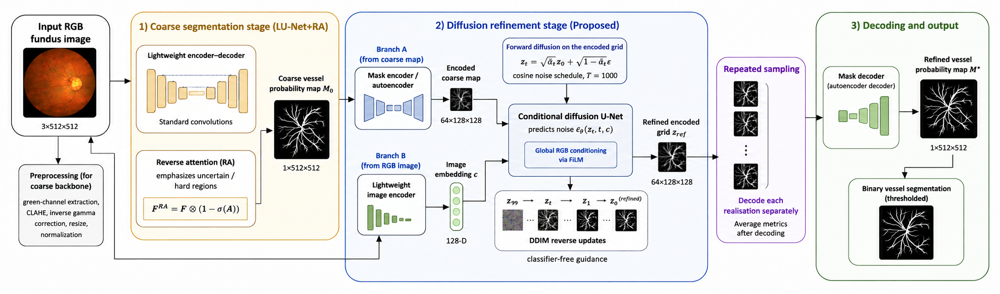

# Refining Retinal Vessel Segmentation with Conditional Diffusion Models

## A Controlled Evaluation on LU-Net+RA Probability Maps

This repository contains the authors' current manuscript, its supporting numerical records, and the experiment source code used by the controlled reference and related studies. Earlier revision packages and development utilities have been removed from the current branch. Previous Git commits and local source archives are preserved.

## Manuscript

- [Latest article PDF](manuscript/last_2026-10-17_10-46-16.pdf) — 23 pages.
- [Latest LaTeX source](manuscript/Overleaf/last_2026-10-17_10-46-16.tex).
- [Complete Overleaf source directory](manuscript/Overleaf/) — upload its contents and select the article TEX as the main document. The MDPI class and figure assets are included.
- [Existing supporting CSV records](results/) — primary, per-image, training-seed and matched OOF summaries. These are copied unchanged; no calculation was rerun during repository rebuilding.

The article version is 2026-10-17_10-46-16. This repository reorganisation does not alter its contents, numerical values, tables or figures.

## Framework diagram



[Download the author-supplied framework diagram](manuscript/figures/proposed_framework_2026-10-17_14-41-56.png). This separately supplied image is included as provided; the compiled article and its LaTeX source are unchanged.

## Current results

Table 6 compares coarse LU-Net+RA with the matched component-study `global_frozen` reference at 50 DDIM updates. Mean Dice ± sample SD across five training-seed means:

| Dataset | Coarse LU-Net+RA | Global/frozen diffusion refiner |
| --- | --- | --- |
| CHASE-DB1 | 0.810514 ± 0.001806 | 0.746146 ± 0.002622 |
| DRIVE | 0.791814 ± 0.007557 | 0.789757 ± 0.008286 |
| HRF | 0.732121 ± 0.003490 | 0.665726 ± 0.006320 |

The tested reference does not improve mean Dice. Table 6 includes exploratory paired confidence intervals; Tables 7–9 contain per-image means; Table 10 reports the matched OOF comparison. OOF nonsignificance does not establish equivalence or rule out training-input shift. Historical positive tables and the separate full-pipeline reproduction are not interchangeable with this reference.

## Code mapped to the manuscript

| Study | Source |
| --- | --- |
| Matched reference and components, Tables 6 and 11 | [run_component_ablations.py](paired_reproduction/run_component_ablations.py), `global_frozen` reference; [report_component_ablations.py](paired_reproduction/report_component_ablations.py) |
| Shared model, data and baseline training | [models.py](diffusion_refiner/models.py), [run.py](paired_reproduction/run.py), [run_drive.py](paired_reproduction/run_drive.py), [run_hrf_baseline.py](paired_reproduction/run_hrf_baseline.py), [official_model.py](paired_reproduction/official_model.py) |
| Matched OOF, Table 10 | [run_oof_comparison.py](paired_reproduction/run_oof_comparison.py) |
| Spatial control, Table 12 | [CHASE](paired_reproduction/run_spatial_residual_refiner.py), [DRIVE/HRF](paired_reproduction/run_spatial_refiner_drive_hrf.py) |
| Fixed-checkpoint sampling, Section 4.8 | [ddim_variability.py](paired_reproduction/ddim_variability.py) |
| Wall-clock and CUDA-event timing, Section 4.9 | [benchmark_pipeline.py](paired_reproduction/benchmark_pipeline.py), [benchmark_cuda_events.py](paired_reproduction/benchmark_cuda_events.py) |

`run_all_datasets_five_full_runs.py` supplies the composition helper used by the matched study drivers. Its separate full-pipeline outputs must not be used as Table 6 results. The corresponding report helper is retained as a code dependency.

The coarse-initialised reference starts at index 99; the target Gaussian-start ablation starts at 999; deterministic controls do not use DDIM. Repeated initial-noise sampling is distinct from independently trained models. The fixed-checkpoint and timing studies have separate protocols and sessions.

## Setup and required artifacts

```powershell
python -m venv .venv
.\.venv\Scripts\Activate.ps1
python -m pip install -r diffusion_refiner/requirements.txt
```

Obtain the datasets from their original providers. The experiment scripts require CUDA and the matching dataset layout, protocol/split files, baseline and autoencoder checkpoints, and, where applicable, saved predictions. Historical relative artifact locations are still present in the scripts: restore the corresponding artifacts there or configure the paths before running. Installing dependencies or cloning this repository alone does not supply those artifacts or reproduce the results. No experiment is run automatically by this repository.

Weights, dataset images and raw probability arrays are not included. Refer to the article's availability statement for retained artifacts; the complete probability arrays for every fixed-checkpoint sampling repeat were not retained. No model training, evaluation, timing or statistical calculation was performed for this repository reorganisation.

## Private correspondence

Reviewer responses and the complete private submission ZIP are deliberately excluded. The current branch contains no dummy datasets, obsolete revision bundles or reviewer-response files. Earlier commits remain in Git history; this update does not erase that history. Overleaf is not updated automatically.
